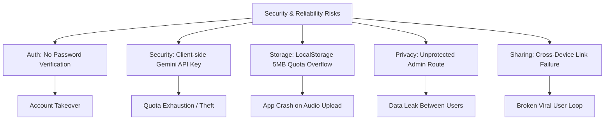
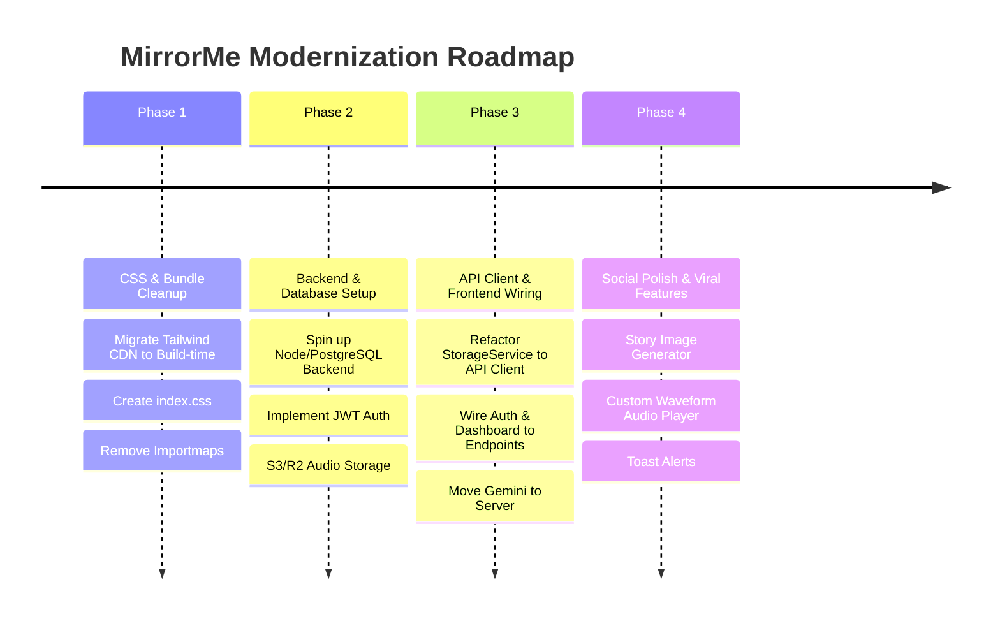

# MirrorMe: Comprehensive Codebase Audit, Backend Integration Blueprint & Design Review

> **Date:** October 26, 2026  
> **Repository:** `mirror-me` (Anonymous Feedback Platform)  
> **Author:** Antigravity AI Code Review & Architecture Team  
> **Status:** Actionable Assessment & Production Roadmap  

---

## Table of Contents
1. [Executive Summary](#1-executive-summary)
2. [Current Architecture & Tech Stack Evaluation](#2-current-architecture--tech-stack-evaluation)
3. [Feature-by-Feature Audit: What Works vs. What Doesn't Work](#3-feature-by-feature-audit-what-works-vs-what-doesnt-work)
   - [Authentication & Session Flow](#31-authentication--session-flow)
   - [Link Generation & Sharing Mechanism](#32-link-generation--sharing-mechanism)
   - [Public Submission (Text & Audio Notes)](#33-public-submission-text--audio-notes)
   - [Recipient Dashboard](#34-recipient-dashboard)
   - [Gemini AI Integration](#35-gemini-ai-integration)
   - [Admin Control Center](#36-admin-control-center)
   - [Build, Assets & Environment Setup](#37-build-assets--environment-setup)
4. [Critical Security, Privacy & Reliability Hazards](#4-critical-security-privacy--reliability-hazards)
5. [Backend Integration Blueprint & API Specification](#5-backend-integration-blueprint--api-specification)
   - [Recommended Backend Architecture](#51-recommended-backend-architecture)
   - [RESTful API Endpoints Contract](#52-restful-api-endpoints-contract)
   - [Relational Database Schema (PostgreSQL / Prisma)](#53-relational-database-schema-postgresql--prisma)
   - [Audio & Media Storage Strategy](#54-audio--media-storage-strategy)
   - [Frontend Client Refactor: From LocalStorage to API Client](#55-frontend-client-refactor-from-localstorage-to-api-client)
6. [Design & UI/UX Audit with Premium Recommendations](#6-design--uiux-audit-with-premium-recommendations)
   - [The "Viral Social" Loop: Instagram / Snapchat Story Card Generator](#61-the-viral-social-loop-instagram--snapchat-story-card-generator)
   - [Custom Waveform Audio Player Component](#62-custom-waveform-audio-player-component)
   - [Purging Tailwind CDN in Favor of Build-Time Tailwind CSS](#63-purging-tailwind-cdn-in-favor-of-build-time-tailwind-css)
   - [Micro-Interactions, Toast Alerts & Visual Polish](#64-micro-interactions-toast-alerts--visual-polish)
7. [Step-by-Step Migration Roadmap](#7-step-by-step-migration-roadmap)

---

## 1. Executive Summary

**MirrorMe** is an anonymous social feedback single-page application (inspired by platforms like NGL, Secret, and Sarahah) designed to let users generate personalized prompt links, collect anonymous text and voice notes from friends, and analyze the collective feedback "vibe" using Google Gemini AI.

### Core Verdict
- **Concept & Foundation:** The core idea is engaging, the user interface follows a clean dark glassmorphism aesthetic (`Plus Jakarta Sans`, Tailwind glass panels, purple/indigo glow gradients), and the frontend features (recording audio via `MediaRecorder`, dynamic routing, copy-to-clipboard, text submission) are functional as a single-browser prototype.
- **The Core Blocker:** **The application is currently entirely confined to `localStorage` on a single browser.** If User A registers on their phone and sends their mirror link to User B on another device, User B's browser accesses an empty `localStorage` and receives a **"Mirror Not Found"** error. For an app whose fundamental value proposition is social sharing across different devices, a remote backend with persistent storage is essential.
- **Security & Quality Issues:** Passwords are not validated or hashed (anyone can sign in as any username with any password), the Gemini API key is bundled into client JavaScript, voice notes are stored as Base64 strings that rapidly breach browser storage quotas, and administrative routes lack authorization checks.

---

## 2. Current Architecture & Tech Stack Evaluation

| Layer | Current Implementation | Assessment | Target State |
| :--- | :--- | :--- | :--- |
| **Framework** | React 19 + TypeScript + Vite 6 | Modern, fast build times (`tsc --noEmit` clean) | Maintain |
| **Routing** | React Router 7 (`HashRouter`) | Uses `/#/` URLs which degrade social media link scrapers & OpenGraph previews | Migrate to `BrowserRouter` with server rewrites |
| **Styling** | Tailwind CSS via CDN (`cdn.tailwindcss.com`) + inline styles | Play CDN causes runtime overhead, FOUC, and console warnings | Native build-time Tailwind CSS (`tailwindcss` + `@tailwindcss/vite` or PostCSS) |
| **Persistence** | `localStorage` (`services/storage.ts`) | Isolated to single browser; max ~5MB quota; prone to total data loss | RESTful API + PostgreSQL / Supabase |
| **AI Integration** | Direct Client-side `@google/genai` calls | Leaks `GEMINI_API_KEY` to browser devtools; unmetered client costs | Backend proxy endpoint (`POST /api/ai/analyze`) |
| **Audio Engine** | `MediaRecorder` + WebM to Base64 in `localStorage` | Works locally; fails on storage limits; Safari WebM compatibility issues | Cloud Object Storage (S3 / Cloudflare R2 / GCS) via presigned URLs |

---

## 3. Feature-by-Feature Audit: What Works vs. What Doesn't Work

### 3.1 Authentication & Session Flow
*File: `pages/Auth.tsx`, `services/storage.ts`, `App.tsx`*

- **What Works:**
  - Fast client-side registration and login simulation.
  - Basic duplicate username/email detection within the local browser storage.
  - Automatic session restoration on page reload (`StorageService.getCurrentUser()`).
  - Graceful sign-out that clears session state and redirects to `/`.
- **What Doesn't Work / Broken:**
  - **No Password Authentication:** During login, `Auth.tsx` only matches `u.username === username.toLowerCase()`. It ignores the password field entirely. Anyone can log into any account by guessing the username.
  - **Plaintext Passwords:** Passwords are never hashed, never salted, and never securely stored.
  - **Single-Device Isolation:** Users created on Chrome desktop do not exist on Mobile Safari or another computer.
  - **No Session Invalidation / Tokens:** No JWTs, no refresh tokens, no HttpOnly cookies.
  - **Weak ID Generation:** User IDs are generated using `Math.random().toString(36).substr(2, 9)`, which has collision risks.

---

### 3.2 Link Generation & Sharing Mechanism
*File: `pages/Dashboard.tsx`, `services/storage.ts`*

- **What Works:**
  - Creation modal with custom Mirror Title and Prompt.
  - Default prompt fallback (`"Tell me something you've been meaning to say..."`).
  - One-click "Copy Share Link" with 2-second visual confirmation ("Copied!").
  - Dynamic link URLs generated with format: `${window.location.origin}/#/u/${user.username}/${id}`.
- **What Doesn't Work / Broken:**
  - **Cross-Device Failure:** When shared via WhatsApp, Instagram, or iMessage, the link fails because the recipient's browser does not possess the creator's `localStorage` data.
  - **Unused Category Type:** `FeedbackLink` interface specifies `'general' | 'advice' | 'confession' | 'first-impression'`, but the modal hardcodes `'general'` without letting users choose a category.
  - **No AI Prompt Suggestions:** `aiService.generatePrompts` is defined in `services/gemini.ts` but never wired into the UI to help users generate creative prompts.
  - **No Link Management:** Users cannot edit, pause, archive, or delete a link once created.
  - **No Analytics on Links:** No view count, submission counter, or click-through statistics.

---

### 3.3 Public Submission (Text & Audio Notes)
*File: `pages/PublicSubmission.tsx`*

- **What Works:**
  - Clear recipient avatar header with username and prompt display.
  - Mode toggle between **Text** and **Voice Note**.
  - Microphone capture using HTML5 `navigator.mediaDevices.getUserMedia` with real-time 30-second timer countdown.
  - Audio playback preview with "Delete and re-record" functionality.
  - Animated submission confirmation screen with options to submit another reflection or create an account.
- **What Doesn't Work / Broken:**
  - **Microphone Error Handling:** Uses native browser `alert()`, which interrupts user experience on mobile.
  - **Audio Codec Issues:** Records `audio/webm`, which lacks full cross-browser playback on some iOS Safari versions without proper transcoding or fallback to `audio/mp4`.
  - **Storage Quota Crash:** Storing 30-second audio files as Base64 in `localStorage` quickly exceeds the 5MB browser quota, causing `QuotaExceededError` crashes on subsequent saves.
  - **No Rate Limiting or Anti-Spam:** An automated script can post unlimited entries in seconds. No reCAPTCHA or IP rate-limiting.
  - **No Profanity / Toxicity Guard:** No word blocklist, automated toxicity detection, or flagging system.
  - **Username Mismatch Bug:** The route is `/u/:username/:linkId`, but the page looks up the link solely by `linkId` from `localStorage` without verifying that `:username` matches the link creator's username.
  - **No Character Limits:** The text area lacks `maxLength`, a visible character counter, or minimum character requirements.

---

### 3.4 Recipient Dashboard
*File: `pages/Dashboard.tsx`*

- **What Works:**
  - Responsive two-column layout: Active Links on the left, Recent Reflections on the right.
  - Empty state graphics when no links or messages exist.
  - Audio reflection cards with playable `<audio>` element.
  - Formatted submission dates (`toLocaleDateString`) with "Anonymous" badges.
- **What Doesn't Work / Broken:**
  - **Native Audio Player Looks Dated:** Uses browser native `<audio>` controls styled with CSS `filter invert grayscale opacity-80`, which renders inconsistently across browsers.
  - **No Message Actions:** Recipient cannot delete, hide, pin, favorite, or report a message.
  - **No Filter by Link:** If a user has 5 different mirror links, all messages are dumped into a single chronological feed without filtering by link.
  - **No Social Story Export:** No feature to convert a message into a shareable branded graphic for Instagram Stories or Snapchat (the primary growth driver for anonymous apps).
  - **Pagination Missing:** All messages are rendered at once; accounts with hundreds of messages will experience DOM lag.

---

### 3.5 Gemini AI Integration
*File: `services/gemini.ts`, `pages/Dashboard.tsx`, `pages/Admin.tsx`*

- **What Works:**
  - AI "Mirror Analysis" prompt crafted to provide supportive, constructive sentiment summaries.
  - Loading spinner states while analysis is processing.
  - Formatted display card with option to dismiss analysis.
- **What Doesn't Work / Broken:**
  - **Client-Side API Key Exposure:** The API key is bundled into frontend assets through Vite's `define` config (`process.env.API_KEY`), making it extractable by inspecting the bundle.
  - **Ignores Audio Messages:** The analysis explicitly filters out audio notes (`messages.filter(m => m.contentType === 'text')`), completely ignoring voice feedback.
  - **Model Deprecation / Hardcoded Name:** Uses `gemini-3-flash-latest`, which may fail or change. With `PLACEHOLDER_API_KEY` in `.env.local`, all requests fail with *"The Mirror is currently foggy"*.
  - **Analysis Results Not Persisted:** Summaries are stored only in React component state; refreshing the page loses the generated analysis, forcing a re-run that consumes more API quota.

---

### 3.6 Admin Control Center
*File: `pages/Admin.tsx`, `components/Navbar.tsx`*

- **What Works:**
  - Summary metric cards (Total Users, Total Messages, Voice Notes).
  - User selection dropdown to filter messages by user.
  - Activity log table showing Recipient, Type, Content Preview, and Date.
  - AI analysis triggered for selected user segments.
- **What Doesn't Work / Broken:**
  - **Zero Access Control:** Any registered user can see the "Admin" link in the navbar and navigate to `/admin`.
  - **Privacy Violation:** Every user can view all messages submitted to all other users in that browser instance.
  - **No Pagination or Search:** Table renders all messages simultaneously with simple truncation.

---

### 3.7 Build, Assets & Environment Setup
*File: `index.html`, `vite.config.ts`, `package.json`*

- **What Works:**
  - Vite dev server runs reliably on port 3000.
  - TypeScript compilation passes with zero type errors (`npx tsc --noEmit`).
  - Production build produces clean output bundles.
- **What Doesn't Work / Broken:**
  - **Missing CSS File:** `index.html` references `<link rel="stylesheet" href="/index.css">`, but `index.css` does not exist in the repository, resulting in a 404 network request.
  - **Redundant Importmap:** `index.html` contains an `importmap` pointing to `esm.sh` CDN URLs alongside Vite's bundled npm dependencies.
  - **Tailwind CDN in Production:** Using `<script src="https://cdn.tailwindcss.com"></script>` is explicitly discouraged for production by the Tailwind team.

---

## 4. Critical Security, Privacy & Reliability Hazards



1. **Broken Cross-Device Sharing (Severity: Blocker):** Links cannot be viewed on other devices due to reliance on `localStorage`.
2. **Public API Key Exposure (Severity: High):** Exposing the Gemini key client-side allows anyone to extract and abuse it.
3. **No Auth Enforcement (Severity: High):** The login form authenticates any user without checking passwords.
4. **LocalStorage Quota Crash (Severity: High):** Base64 audio rapidly hits the 5MB storage limit and triggers unhandled runtime exceptions.
5. **Open Admin Route (Severity: Medium):** Sensitive messages and user logs are visible to any signed-in user.

---

## 5. Backend Integration Blueprint & API Specification

To transform MirrorMe into a fully functioning multi-user platform, the client must communicate with a dedicated backend.

### 5.1 Recommended Backend Architecture
- **Runtime:** Node.js (Express / Fastify / NestJS) or Python (FastAPI).
- **Database:** PostgreSQL (with Prisma ORM or Drizzle) or Supabase.
- **File Storage:** AWS S3, Cloudflare R2, or Supabase Storage for audio files.
- **Authentication:** JWT in `HttpOnly`, `SameSite=Lax` cookies (or Authorization Bearer tokens).
- **AI Processing:** Server-side Google GenAI SDK calls protected behind authentication and rate limits.

---

### 5.2 RESTful API Endpoints Contract

#### 🔐 Authentication Endpoints
```http
POST /api/v1/auth/register
Content-Type: application/json

Request Body:
{
  "username": "johndoe",
  "email": "john@example.com",
  "password": "SecurePassword123!"
}

Response (201 Created):
{
  "success": true,
  "token": "jwt_token_string",
  "user": {
    "id": "usr_9x8a7b6c",
    "username": "johndoe",
    "email": "john@example.com",
    "role": "user",
    "createdAt": "2026-10-26T10:00:00Z"
  }
}
```

```http
POST /api/v1/auth/login
Content-Type: application/json

Request Body:
{
  "username": "johndoe",
  "password": "SecurePassword123!"
}

Response (200 OK):
{
  "success": true,
  "token": "jwt_token_string",
  "user": {
    "id": "usr_9x8a7b6c",
    "username": "johndoe",
    "email": "john@example.com",
    "role": "user"
  }
}
```

```http
GET /api/v1/auth/me
Header: Authorization: Bearer <token>

Response (200 OK):
{
  "id": "usr_9x8a7b6c",
  "username": "johndoe",
  "email": "john@example.com",
  "role": "user"
}
```

---

#### 🔗 Feedback Link Endpoints (Authenticated)
```http
GET /api/v1/links
Header: Authorization: Bearer <token>

Response (200 OK):
[
  {
    "id": "lnk_abc123",
    "userId": "usr_9x8a7b6c",
    "title": "Honestly thinking about me...",
    "prompt": "What is one thing I should stop doing?",
    "type": "advice",
    "createdAt": "2026-10-26T10:15:00Z",
    "messagesCount": 8
  }
]
```

```http
POST /api/v1/links
Header: Authorization: Bearer <token>
Content-Type: application/json

Request Body:
{
  "title": "First Impressions",
  "prompt": "What was your genuine first impression of me?",
  "type": "first-impression"
}

Response (201 Created):
{
  "id": "lnk_xyz789",
  "userId": "usr_9x8a7b6c",
  "title": "First Impressions",
  "prompt": "What was your genuine first impression of me?",
  "type": "first-impression",
  "createdAt": "2026-10-26T10:30:00Z"
}
```

```http
DELETE /api/v1/links/:linkId
Header: Authorization: Bearer <token>

Response (200 OK):
{
  "success": true,
  "message": "Link deleted successfully"
}
```

---

#### 🌐 Public Submission Endpoints (No Auth Required)
```http
GET /api/v1/public/links/:username/:linkId

Response (200 OK):
{
  "linkId": "lnk_xyz789",
  "recipientUsername": "johndoe",
  "recipientAvatarUrl": "https://api.dicebear.com/7.x/shapes/svg?seed=johndoe",
  "title": "First Impressions",
  "prompt": "What was your genuine first impression of me?",
  "type": "first-impression"
}
```

```http
POST /api/v1/public/links/:linkId/messages
Content-Type: multipart/form-data  (or JSON for text-only)

Form Data:
- contentType: "text" | "audio"
- content: "You always brighten up the room!" (if text)
- audio: <audio/webm binary file> (if audio)

Response (201 Created):
{
  "success": true,
  "message": "Reflection sent anonymously"
}
```

---

#### 📬 Message Management & AI Insights (Authenticated)
```http
GET /api/v1/messages?linkId=lnk_xyz789&page=1&limit=20
Header: Authorization: Bearer <token>

Response (200 OK):
{
  "messages": [
    {
      "id": "msg_001",
      "linkId": "lnk_xyz789",
      "contentType": "text",
      "content": "You always brighten up the room!",
      "createdAt": "2026-10-26T11:00:00Z",
      "sentiment": "positive"
    },
    {
      "id": "msg_002",
      "linkId": "lnk_xyz789",
      "contentType": "audio",
      "audioUrl": "https://cdn.mirrorme.app/audio/msg_002.webm",
      "createdAt": "2026-10-26T11:05:00Z"
    }
  ],
  "pagination": {
    "total": 2,
    "page": 1,
    "totalPages": 1
  }
}
```

```http
DELETE /api/v1/messages/:messageId
Header: Authorization: Bearer <token>

Response (200 OK):
{
  "success": true,
  "message": "Message deleted"
}
```

```http
POST /api/v1/ai/analyze
Header: Authorization: Bearer <token>
Content-Type: application/json

Request Body:
{
  "linkId": "lnk_xyz789" // optional; if omitted, analyzes all user messages
}

Response (200 OK):
{
  "summary": "Your circle sees you as exceptionally empathetic and creative. People appreciate your warmth in group settings.",
  "traits": ["Empathetic", "Reliable", "Charismatic"],
  "gentleAdvice": "Take some time for your own boundaries; friends notice you tend to over-commit.",
  "generatedAt": "2026-10-26T11:10:00Z"
}
```

```http
GET /api/v1/ai/prompts?topic=friendship
Header: Authorization: Bearer <token>

Response (200 OK):
{
  "prompts": [
    "What's one thing you'll never say to my face?",
    "If our friendship was a movie genre, what would it be?",
    "What's my biggest red flag and biggest green flag?"
  ]
}
```

---

### 5.3 Relational Database Schema (PostgreSQL / Prisma)

```prisma
datasource db {
  provider = "postgresql"
  url      = env("DATABASE_URL")
}

generator client {
  provider = "prisma-client-js"
}

enum Role {
  USER
  ADMIN
}

enum LinkType {
  GENERAL
  ADVICE
  CONFESSION
  FIRST_IMPRESSION
}

enum ContentType {
  TEXT
  AUDIO
}

model User {
  id           String         @id @default(cuid())
  username     String         @unique
  email        String         @unique
  passwordHash String
  role         Role           @default(USER)
  avatarUrl    String?
  createdAt    DateTime       @default(now())
  updatedAt    DateTime       @updatedAt

  links        FeedbackLink[]
  messages     Message[]      @relation("ReceivedMessages")
  analyses     AiAnalysis[]

  @@index([username])
}

model FeedbackLink {
  id        String       @id @default(cuid())
  userId    String
  user      User         @relation(fields: [userId], references: [id], onDelete: Cascade)
  title     String
  prompt    String
  type      LinkType     @default(GENERAL)
  isActive  Boolean      @default(true)
  createdAt DateTime     @default(now())
  updatedAt DateTime     @updatedAt

  messages  Message[]

  @@index([userId])
}

model Message {
  id          String       @id @default(cuid())
  linkId      String
  link        FeedbackLink @relation(fields: [linkId], references: [id], onDelete: Cascade)
  recipientId String
  recipient   User         @relation("ReceivedMessages", fields: [recipientId], references: [id], onDelete: Cascade)
  
  contentType ContentType
  content     String?      @db.Text
  audioUrl    String?      // Cloud Storage URL
  sentiment   String?
  isRead      Boolean      @default(false)
  isReported  Boolean      @default(false)
  createdAt   DateTime     @default(now())

  @@index([linkId])
  @@index([recipientId])
}

model AiAnalysis {
  id           String       @id @default(cuid())
  userId       String
  user         User         @relation(fields: [userId], references: [id], onDelete: Cascade)
  summaryText  String       @db.Text
  traits       String[]
  advice       String?      @db.Text
  createdAt    DateTime     @default(now())

  @@index([userId])
}
```

---

### 5.4 Audio & Media Storage Strategy

1. **Direct Presigned URLs (Recommended for Performance):**
   - Client requests upload ticket: `POST /api/v1/media/presign-upload` -> receives `{ uploadUrl, key }`.
   - Client uploads raw WebM blob directly to S3 / Cloudflare R2 bucket.
   - Client submits the message payload containing the media key to `POST /api/v1/public/links/:linkId/messages`.
2. **Audio Transcoding:**
   - On upload, a serverless background worker (or simple ffmpeg process) ensures recordings are encoded as standard AAC/MP4 or WebM with broad mobile browser compatibility.

---

### 5.5 Frontend Client Refactor: From LocalStorage to API Client

Create a unified API service (`services/api.ts`) that replaces `StorageService`:

```typescript
// services/api.ts
const API_BASE = import.meta.env.VITE_API_BASE_URL || '/api/v1';

export const apiClient = async <T>(endpoint: string, options: RequestInit = {}): Promise<T> => {
  const token = localStorage.getItem('mirror_me_token');
  const headers: Record<string, string> = {
    'Content-Type': 'application/json',
    ...(options.headers as Record<string, string>),
  };

  if (token) {
    headers['Authorization'] = `Bearer ${token}`;
  }

  const response = await fetch(`${API_BASE}${endpoint}`, {
    ...options,
    headers,
  });

  if (!response.ok) {
    const errorData = await response.json().catch(() => ({}));
    throw new Error(errorData.message || `Request failed with status ${response.status}`);
  }

  return response.json();
};
```

---

## 6. Design & UI/UX Audit with Premium Recommendations

### 6.1 The "Viral Social" Loop: Instagram / Snapchat Story Card Generator

**The Problem:** Apps like NGL succeed because receiving an anonymous reflection is only half the experience. The viral growth comes from users **sharing their received feedback as attractive image cards to their Instagram Stories**, encouraging followers to submit feedback too.

**Recommendation:**
- Add a **"Share to Story"** button on each message card in `Dashboard.tsx`.
- Use a client-side card renderer (such as `html-to-image` or HTML Canvas) to generate a high-resolution 9:16 vertical story card featuring:
  1. The original prompt badge.
  2. The anonymous friend's message in bold typography.
  3. A branded footer: *"Send me an anonymous reflection on MirrorMe 👉 /u/username"*.
  4. One-click "Download Story Card" or native Web Share API trigger (`navigator.share({ files: [...] })`).

---

### 6.2 Custom Waveform Audio Player Component

**The Problem:** Native HTML5 `<audio controls>` renders differently on every browser, cannot be themed to match glassmorphism, and looks out of place in modern dark mode.

**Recommendation:**
- Implement a custom audio player with:
  - Play/Pause toggle with smooth SVG morphing.
  - Interactive scrubbing bar or simulated audio waveform bars.
  - Duration and playback timer display.
  - Dynamic gradient fill that reacts to playback progress.

---

### 6.3 Purging Tailwind CDN in Favor of Build-Time Tailwind CSS

**The Problem:** `index.html` loads `<script src="https://cdn.tailwindcss.com"></script>`. In production builds, this causes console warnings, flashes of unstyled content (FOUC), and prevents CSS minification and purging.

**Recommendation:**
1. Install Tailwind CSS and its Vite plugin:
   ```bash
   npm install -D tailwindcss @tailwindcss/vite
   ```
2. Configure `vite.config.ts`:
   ```typescript
   import tailwindcss from '@tailwindcss/vite';
   export default defineConfig({
     plugins: [react(), tailwindcss()],
   });
   ```
3. Create `index.css`:
   ```css
   @import "tailwindcss";
   
   @layer base {
     body {
       font-family: 'Plus Jakarta Sans', sans-serif;
       background-color: #020617;
       color: #f8fafc;
     }
   }
   
   .glass {
     background: rgba(255, 255, 255, 0.03);
     backdrop-filter: blur(16px);
     border: 1px solid rgba(255, 255, 255, 0.08);
   }
   ```
4. Remove the CDN script and importmap from `index.html`.

---

### 6.4 Micro-Interactions, Toast Alerts & Visual Polish

1. **Toast Notification System:** Replace inline states and `alert()` popups with a lightweight toast library (e.g., `sonner`). Display clear alerts for:
   - "Link copied to clipboard!"
   - "Reflection sent anonymously."
   - "Microphone permission required to record audio."
2. **Skeleton Loaders:** Add animated pulsing placeholder cards when loading links, messages, and AI summaries to eliminate jarring content layout shifts.
3. **Empty States with Action Prompts:** Enrich empty dashboard states with clickable prompt suggestions (e.g., *"Try: 'What's my biggest strength?'"*).
4. **Haptic & Sound Feedback (Optional):** Subtle audio/haptic clicks on recording start/stop and message submission to improve mobile feel.

---

## 7. Step-by-Step Migration Roadmap



### Phase 1: Frontend Hygiene & Bundling (Day 1)
- [ ] Remove `https://cdn.tailwindcss.com` and ESM importmap from `index.html`.
- [ ] Install and configure build-time Tailwind CSS.
- [ ] Create missing `index.css` with custom glass tokens and typography imports.
- [ ] Switch from `HashRouter` to `BrowserRouter` (with SPA rewrite config).

### Phase 2: Backend & Database Foundation (Days 2 - 3)
- [ ] Initialize backend service (Express/Fastify/NestJS or Supabase).
- [ ] Configure PostgreSQL database with the Prisma schema provided in Section 5.3.
- [ ] Implement password hashing with bcrypt/argon2 and JWT authentication.
- [ ] Set up Cloud Object Storage (S3 / R2) for audio uploads.
- [ ] Move Google Gemini API integration from frontend to backend (`POST /api/v1/ai/analyze`).

### Phase 3: Frontend Service Layer Migration (Days 4 - 5)
- [ ] Implement `services/api.ts` with typed endpoints and error handling.
- [ ] Replace `services/storage.ts` calls in `Auth.tsx`, `Dashboard.tsx`, `PublicSubmission.tsx`, and `Admin.tsx`.
- [ ] Wire up real authentication state in `App.tsx` with protected route guards.
- [ ] Connect the Link creation modal to `aiService.generatePrompts` for AI-assisted prompts.

### Phase 4: Viral Social & UI/UX Enhancement (Days 6 - 7)
- [ ] Build the **"Share to Instagram Story"** canvas image generator for reflections.
- [ ] Build the custom waveform audio player for voice notes.
- [ ] Integrate `sonner` for toast notifications.
- [ ] Add content moderation/word filtering to anonymous submissions.

---

*Report prepared and validated for the `mirror-me` project repository.*
